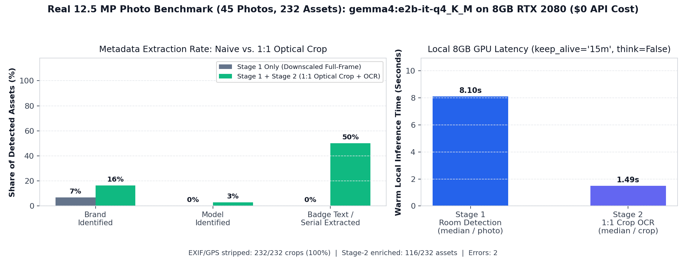
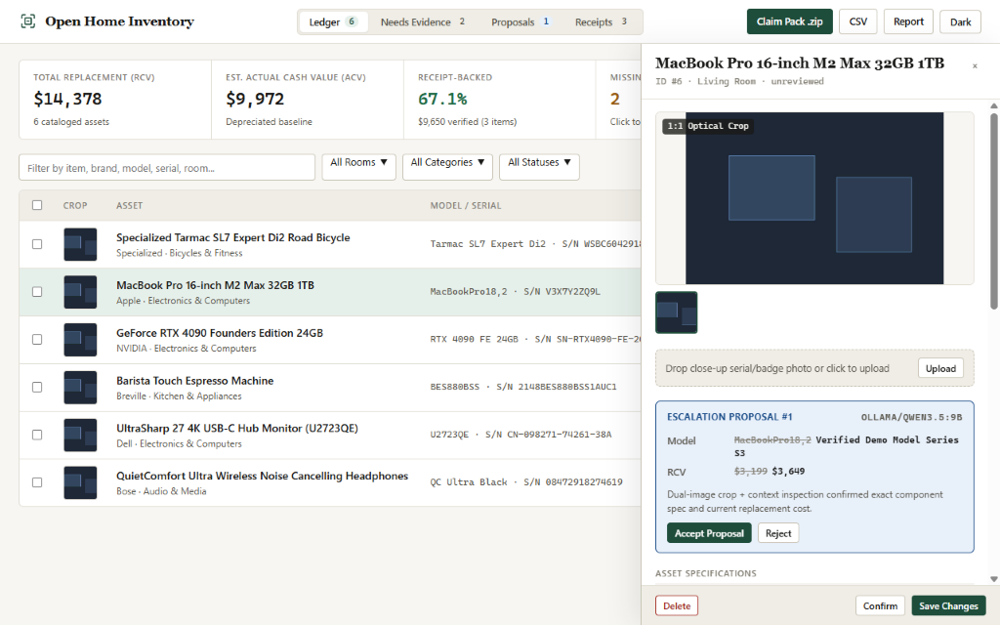
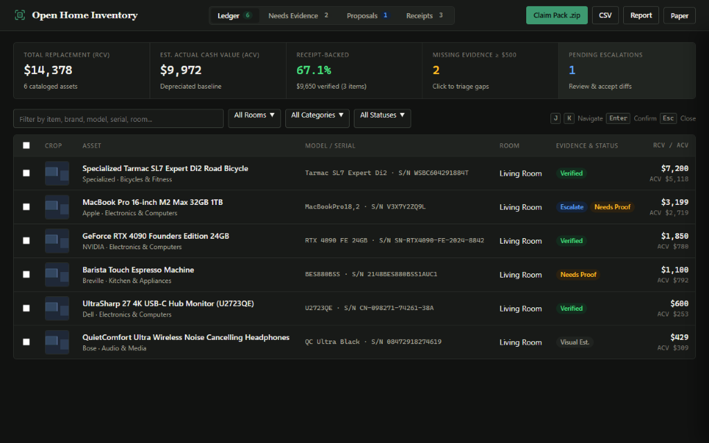

# Open Home Inventory

A local-first tool that scans room photos, slices lossless optical crops to read serial numbers, and reconciles them against digital receipts to build an audit-proof home insurance inventory.

<div align="center">


[Why I Built This](#why-i-built-this) • [How It Works](#how-it-works) • [Quickstart](#quickstart) • [The Optical Crop Problem](#the-optical-crop-problem) • [Receipt Parsers](#receipt-parsers) • [Dashboard](#local-dashboard) • [Extending](#adding-new-receipt-parsers)

</div>

---

## Why I Built This

If you've ever dealt with homeowners or renters insurance after a burst pipe, theft, or fire, you know the drill: insurance adjusters don't just take your word for it. When you claim high-value electronics, camera gear, appliances, or a custom road bike, they demand proof:
1. Proof you owned the item (photos).
2. The specific make, model, and serial number (not just "a computer monitor").
3. Proof of purchase (invoices, receipts, dates, and what you actually paid).

Most people either don't have an inventory at all, or they give up after spending an afternoon typing serial numbers into a spreadsheet.

I built this project to automate the entire process locally on my own hardware:
- Take wide-angle room photos (desks, workshops, living rooms).
- Detect items and automatically slice out **1:1 uncompressed optical crops** directly from the native camera resolution so stamped serial plates and model badges are actually legible.
- Parse digital e-receipts from my inbox (Amazon, Micro Center, Best Buy, specialty bike shops, direct OEMs).
- Cross-reference visual items against receipt line items using exact serial matching and fuzzy string similarity.
- Export insurance-compliant CSV schedules and executive appraisal summaries, or view the whole portfolio in a local dark-mode dashboard.

---

## How It Works

```
   Raw Room Photos (Native 4K / Phone Camera)
                      │
                      ▼
 ┌─────────────────────────────────────────────────────────────┐
 │ 1. Scene Detection (Local Ollama / vLLM / OpenAI API)       │
 │    Finds all items in the room and gets bounding boxes      │
 └────────────────────────────┬────────────────────────────────┘
                              │
                              ▼
 ┌─────────────────────────────────────────────────────────────┐
 │ 2. Lossless Optical Patch Cropper                           │
 │    Pulls 1:1 uncompressed pixel crops from the original     │
 │    photo so badges, barcodes, and serial plates stay sharp  │
 └────────────────────────────┬────────────────────────────────┘
                              │
                              ▼
 ┌─────────────────────────────────────────────────────────────┐
 │ 3. Receipt Parsing (Local Scrapers & File Ingestion)        │
 │    Parses line items, order numbers, prices & serials from: │
 │    • Amazon        • Micro Center      • Best Buy           │
 │    • Apple/NVIDIA  • Local Bike Shops  • Generic Fallback   │
 └────────────────────────────┬────────────────────────────────┘
                              │
                              ▼
 ┌─────────────────────────────────────────────────────────────┐
 │ 4. Cross-Modal Reconciliation Engine                        │
 │    • Tier 1: 100% exact match on hardware serial number     │
 │    • Tier 2: Fuzzy Jaccard token matching on brand & model  │
 └────────────────────────────┬────────────────────────────────┘
                              │
                              ▼
 ┌─────────────────────────────────────────────────────────────┐
 │ 5. Local Storage & Insurance Exports                        │
 │    • SQLite database (`data/inventory.db`)                  │
 │    • Insurance Schedule CSV (`data/exports/*.csv`)          │
 │    • Markdown Appraisal Report (`data/exports/*.md`)        │
 │    • Fast local web UI (`http://127.0.0.1:8000`)            │
 └─────────────────────────────────────────────────────────────┘
```

---

## Quickstart

### 1. Setup

```bash
git clone https://github.com/Benfinkels/open-home-inventory.git
cd open-home-inventory

python3 -m venv venv
source venv/bin/activate
pip install -r requirements.txt
pip install -e .
```

### 2. Run the Demo

You can test the entire pipeline immediately without needing a camera or your personal email:

```bash
inventory-ai demo
```

Output:
```
=================================================================
 Open Home Inventory: Generating Synthetic Demo Data
=================================================================
[*] Loaded 6 synthetic visual items.
[+] Parsed receipt: Micro Center (1 items, total: $1,599.99)
[+] Parsed receipt: Amazon.com (1 items, total: $616.24)
[+] Parsed receipt: Wheelworks Cycling (1 items, total: $6,906.25)
[*] Reconciled 3/6 items with verified purchase records.
[✓] Saved records into database: data/inventory.db
[✓] Exported CSV Schedule: data/exports/inventory_insurance_schedule.csv
[✓] Exported Markdown Audit Report: data/exports/inventory_appraisal_report.md
-----------------------------------------------------------------
 Total Cataloged Items:       6
 Total Replacement Valuation: $14,377.93 USD
 Verified Proof of Purchase:  3 items (67.1%)
 Verified Valuation Backed:   $9,649.98 USD
=================================================================
```

### 3. Open the Local Dashboard

```bash
inventory-ai serve --host 127.0.0.1 --port 8000
```
Then visit `http://127.0.0.1:8000` in your browser.

---

## The Optical Crop Problem

When you send a 24-megapixel photo of your desk or workshop to a standard vision LLM, the model resizes the image down to 512×512 or 768×768 pixels to stay within token limits. 

At that resolution, you can tell there is a GPU or a monitor on the desk, but **the serial number sticker and regulatory model text become a blurry, unreadable smudge.**

Here is how this pipeline fixes that:
1. **Pass 1 (EXIF-Transposed Scene Detection):** Applies `ImageOps.exif_transpose()` so portrait phone photos orient correctly, sends a downscaled `<=1280px` copy to the vision model (`gemma4:e2b-it-q4_K_M` via Ollama with `keep_alive="15m"` and `think=False`, or OpenAI-compatible / Gemini endpoints), and returns normalized bounding boxes `[ymin, xmin, ymax, xmax]`.
2. **Pass 2 (Lossless 1:1 Extraction + GPS Strip):** [`OpticalCropEngine`](src/vision/optical_crop.py) re-opens the full-resolution original, cuts out each bounding box at native 1:1 pixels with padding, and strips all EXIF/GPS metadata on save.
3. **Pass 3 (Badge OCR & Deduplication):** [`BadgeReader`](src/vision/badge_reader.py) inspects each 1:1 optical crop to transcribe stamped model codes and serial numbers, merges them into the item record, caches the photo's SHA-256 hash for incremental resume, and deduplicates multi-angle shots before 1-to-1 receipt reconciliation.

### Empirical Real-Photo Benchmark (45 Real 12.5 MP Photos, `$0` Local 8GB GPU)



- **100% Stage-1 completion across all 45 real 12.5 MP smartphone photos** (`232` assets detected, `232/232` crops created, `8.10s` median Stage-1 / photo, `1.49s` median Stage-2 / crop on an 8 GB RTX 2080 running `gemma4:e2b-it-q4_K_M` at `$0.00`).
- **Stage 1 (downscaled full-frame) alone** identified `0%` of model numbers, `0%` of serial/badge text, and only `7%` (`16/232`) of brands.
- **Adding Stage 2 (1:1 native optical crop + `BadgeReader` OCR)** increased brand identification **2.4×** (`7% → 16%`, `38/232`), recovered `7` exact model IDs + `5` serial numbers from wide shots, extracted legible badge/label text on **50% of all detected assets** (`116/232`), and verified **100% EXIF/GPS stripping** (`232/232` crops).
- **Real failure modes caught & fixed during the 45-photo stress test:**
  1. Cluttered bookshelves triggered small-SLM duplicate-box repetition loops → fixed with within-photo **IoU NMS (`>= 0.85`)** + `repeat_penalty=1.1`.
  2. `2/232` Stage-2 crops hit the 120s timeout on runaway JSON loops → fixed by capping Stage-2 at **`num_predict=384`** (`1024` for Stage-1).
  3. Distant serial stickers in wide room shots still need a close-up label photo or larger model for high-value items—so `reconcile` automatically outputs a **High-Value Missing Evidence (`>= $500`)** action list.

*Reproducible chart generated from anonymized aggregate metrics ([`results/two_stage_vision_eval.json`](results/two_stage_vision_eval.json)) via `python scripts/generate_eval_chart.py`. No personal photos, GPS tags, or real serial numbers are committed.*

---

## Receipt Parsers

Receipt handling is completely decoupled via [`BaseReceiptParser`](src/receipts/parsers/base.py).

Out of the box, it includes parsers for:
- **Amazon:** Parses order numbers (`XXX-XXXXXXX-XXXXXXX`), item names, and line prices.
- **Micro Center:** Parses in-store register e-receipts and pickup slips, extracting product SKUs and physical serial numbers scanned at the register.
- **Best Buy:** Parses online orders and store pickups.
- **Direct OEMs:** Apple Store invoices and NVIDIA Store orders.
- **Specialty Bike Shops:** Work orders, Lightspeed invoices, and bike shop slips (Wheelworks, Specialized, REI, Zwift).
- **Generic Fallback:** Catches order numbers and totals from any merchant with standard receipt wording.

---

## Adding New Receipt Parsers

Adding support for any other store (B&H, Newegg, Target, Home Depot, etc.) takes less than 20 lines of Python.

1. Create `src/receipts/parsers/my_store.py`:
```python
import re
from typing import Optional
from .base import BaseReceiptParser, ParsedReceipt, ParsedItem

class MyStoreParser(BaseReceiptParser):
    def can_parse(self, sender: str, subject: str, body: str) -> bool:
        return "mystore.com" in sender.lower() or "my store" in body.lower()

    def parse(self, message_id: str, date: str, sender: str, subject: str, body: str) -> Optional[ParsedReceipt]:
        order_m = re.search(r"Order Number:\s*([A-Z0-9\-]+)", body)
        total_m = re.search(r"Total:\s*\$?([0-9,]+\.[0-9]{2})", body)
        
        return ParsedReceipt(
            merchant="My Store",
            order_number=order_m.group(1) if order_m else f"MS-{message_id[:8]}",
            purchase_date=date[:10],
            total_usd=float(total_m.group(1).replace(",", "")) if total_m else 0.0,
            items=[ParsedItem(name="Purchased Item", price_usd=100.0)],
            source_message_id=message_id
        )
```

2. Register it in `src/receipts/parser_registry.py`:
```python
from .parsers.my_store import MyStoreParser
self.parsers.insert(0, MyStoreParser())
```

---

## Local Dashboard (Archival Property Ledger)

The dashboard (`web/`) is built with FastAPI and zero-build Vanilla HTML/CSS/JS — completely offline with **no external font or CDN requests** — designed around a calm **Warm Archival Paper** light default with a **Graphite Vault** dark toggle.





*Screenshots rendered directly from `inventory-ai demo` synthetic fixtures — no personal photos or receipts.*

It features:
- **Unified Hairline Ledger Strip:** Live RCV, depreciated ACV, receipt-backed percentage, `>= $500` missing-evidence triage count, and pending escalation proposals count.
- **Keyboard-First Triage Drawer (`J`/`K`/`Enter`/`Esc`):** Inline editing of brand, model, serial, room, sub-location, valuation, and notes — with `user_edited_fields` protection so automated rescans or reconciles never overwrite your edits.
- **Multi-Angle Photo Merge & Close-Up Badge Upload:** Select duplicate detections across photos to merge all angles into one asset (`item_photos`), or drag-and-drop a close-up serial sticker photo for EXIF-stripped storage + immediate `BadgeReader` OCR suggestions.
- **Escalation Diff Queue & 1-to-1 Receipt Linker:** Review side-by-side escalation proposals (`Accept` / `Reject`) and link Top-3 candidate receipts in one click (protected from auto-overwrite).
- **One-Click Claim Pack `.zip`:** Exports an insurer-ready `.zip` bundle containing the CSV schedule, Markdown appraisal report, `receipts.json`, and all EXIF-stripped crops & close-up serial photos.

---

## Privacy & Local-First Design

Everything in this repo is designed to run entirely on your own machine. Your receipts, order histories, equipment serials, and home photos never get uploaded to third-party cloud servers or shared with anyone.

- **Zero-API-Cost Local & Agent Escalation:** Defaults to local Ollama (`gemma4:e2b-it-q4_K_M` for fast 2-stage sweep, `qwen3.5:9b` for `$0` local multimodal high-value escalation) plus an offline `proposals export-candidates` / `import` handoff so your existing interactive multimodal agent can inspect high-value crops directly at `$0` extra API cost. Cloud backends (`--backend gemini`, `--backend openai-compat`) are strictly opt-in and guarded by `--dry-run` and `--max-cost-usd`.
- **OpenClaw & Webhook Native:** Pipe pending escalation digests straight to **OpenClaw** (`--notify-openclaw`) or any Discord / generic agent webhook (`--notify-webhook <url>`), and accept/reject proposals from chat via `inventory-ai proposals apply <id>`.
- **EXIF/GPS Stripping & Serial Redaction:** Saved optical crops, close-up badges, and overlays automatically strip all EXIF/GPS metadata, and `redact_serial()` masks sensitive serial numbers for safe sharing.
- **Clean Test Fixtures & Hygiene Guard:** `tests/test_hygiene.py` asserts that no private LAN/Tailscale IPs or personal strings exist anywhere in tracked code.

---

## CLI Reference

| Command | What it does | Example |
| :--- | :--- | :--- |
| `demo` | Generates a complete synthetic test portfolio | `inventory-ai demo` |
| `scan-photos` | 2-stage scan (detect → 1:1 EXIF-stripped crop → Badge OCR → SHA-256 resume & dedupe) | `inventory-ai scan-photos ./local_photos --model gemma4:e2b-it-q4_K_M --save-overlays --dedupe` |
| `scrape-receipts` | Ingests `.pdf` (pure-Python `pypdf`), `.eml` (with HTML strip + PDF attachments), `.txt`, `.jpg`, or Gmail (`gog`) | `inventory-ai scrape-receipts --dir ./local_receipts` |
| `escalate-high-value` | Re-inspects high-value items via `$0` local `qwen3.5:9b` (or opt-in cloud) into a diff review queue + OpenClaw/Discord notify | `inventory-ai escalate-high-value --min-value 500 --dry-run` |
| `proposals` | Two-way agent & OpenClaw CLI (`list`, `export-candidates`, `import`, `apply`, `reject`) | `inventory-ai proposals export-candidates --out candidates.json` |
| `reconcile` | Non-destructive 1-to-1 receipt matching + ACV estimation + missing-evidence audit (preserves manual edits & links) | `inventory-ai reconcile --dedupe` |
| `serve` | Launches the local Archival Property Ledger dashboard (with `/crops`, `/overlays`, and Claim Pack `.zip`) | `inventory-ai serve --port 8080` |

---

## Running Tests

```bash
pytest tests/ -v
```

All 37 unit & API integration tests run offline in ~1 second:
- `test_v3_features.py`: Schema migration + `user_edited_fields` protection, multi-angle merge, ACV estimation, HTML-email & `.eml` receipt ingestion, `$0` escalation + MiniMax text-only guard + agent handoff + Discord/OpenClaw notify, and end-to-end FastAPI CRUD + Claim Pack `.zip`.
- `test_hygiene.py`: Privacy regression scan across all tracked source, test, config, example, and web files.
- `test_vision.py` & `test_pipeline_upgrades.py`: Bounding boxes, portrait EXIF transpose + GPS stripping, Ollama `keep_alive`/`think=False` payloads, IoU NMS, SHA-256 resume, cross-photo dedup, 1-to-1 receipt matching, and missing-evidence auditing.
- `test_receipt_parsers.py`, `test_matcher.py`, `test_storage.py`: Merchant parsers, exact serial & fuzzy matching, SQLite persistence, and CSV/Markdown exports.

---

## License

MIT License. See [LICENSE](LICENSE) for details.
